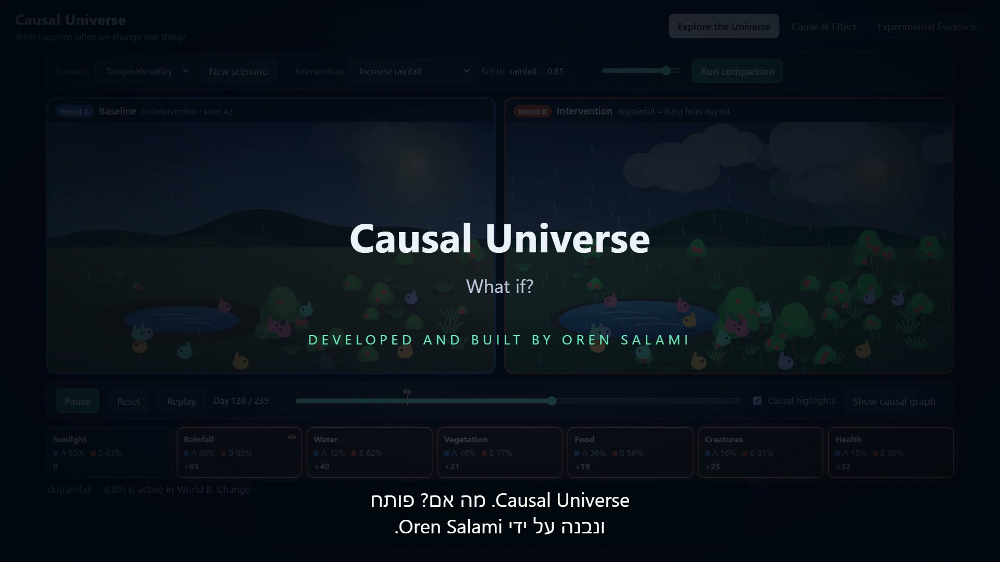

# Causal Universe: What If?

**A small living world you can reach into, to see what a change really causes.**

[](docs/demo-video/causal-universe-demo.mp4)

▶ **[Watch the 2-minute demonstration video](docs/demo-video/causal-universe-demo.mp4)** (English narration, Hebrew subtitles)

---

## What is it?

Causal Universe is an interactive miniature ecosystem. Rain fills a pond, water grows plants, plants bear food, food feeds a population of small creatures. You watch it live on screen.

Then you make a twin of that world, change exactly one thing in the twin, and watch the two drift apart.


*World A is left alone. In World B, rainfall was set to 85% on day 60. Same starting point, same random weather, one difference.*

## Why does it matter?

Most of what we know comes from watching: people who exercise live longer, cities with more police have more crime, rainy places look a certain way. Watching tells you what goes together. It does not tell you what would happen if you *changed* something.

Those are different questions, and they can have opposite answers. This project shows that happening:

> Across 300 simulated worlds that were only observed, **rainier worlds had fewer plants**.
> When rain was deliberately increased in those same worlds, **plants grew**.

Nothing is broken there. Sunny climates in this world get less rain *and* grow plants faster, so sunshine is quietly responsible for the pattern. Only an intervention separates what rain does from what merely travels with it.

## How does it work?

### The world

Seven quantities, each between 0 and 1, updated once per simulated day:


Each arrow means "is an ingredient of". Every variable has one short equation that combines its ingredients with a little random noise. For example, water keeps 88% of yesterday's level and takes 12% from today's rain. The full set is in [docs/causal-model.md](docs/causal-model.md).

### Three things you can do

| | What it means | In the app |
|---|---|---|
| **Observe** | Let the world run and look | Press *Start* |
| **Intervene** | Overrule one equation and pin its variable to a value you choose, written `do(rainfall = 0.85)` | Pick an intervention, set its strength, press *Run comparison* |
| **Compare** | Run the untouched world and the changed world with identical randomness, so any difference is due to your change | The two worlds play side by side |

An intervention here is a real operation on the model. The rainfall equation is switched off and replaced with your number. It is not a filter that picks out rainy days from existing data.

### Three views

**Explore the Universe.** Two animated worlds on one clock. A strip underneath lights up each variable at the moment the worlds begin to differ, so you see the change travel down the chain.

**Cause & Effect.** The causal graph, drawn from the same list of arrows the simulation runs on. During an intervention, the arrow into the changed variable is shown cut, and everything downstream lights up. Select any variable to read its equation.


**Experimental Evidence.** The measurements: time-series charts for both worlds, a table of effects, and four research experiments.

### Under the hood


A Python backend (FastAPI + NumPy) does all the science. A TypeScript frontend (Canvas, no framework) draws what the backend returns and computes nothing of its own. Both ship in a single Docker container. More in [docs/architecture.md](docs/architecture.md).

## The research behind it

The project is a hands-on illustration of ideas from **Judea Pearl's** work on causality:

- **Structural causal models**: describing a system as variables, each set by an equation of its causes
- **The do-operator**: the formal difference between *seeing* that X is high and *making* X high
- **Confounding**: a hidden common cause that makes two things move together
- **Counterfactual comparison**: the same world under a different choice

| Source | Link |
|---|---|
| Pearl, J. (2009). *Causality: Models, Reasoning, and Inference* (2nd ed.). Cambridge University Press | <https://bayes.cs.ucla.edu/BOOK-2K/> |
| Pearl, J. (2010). Causal Inference. *PMLR* 6:39–58 | <https://proceedings.mlr.press/v6/pearl10a.html> |
| Pearl, J. (2013). Structural Counterfactuals: A Brief Introduction. *Cognitive Science* 37(6), 977–985 | <https://doi.org/10.1111/cogs.12065> |

[docs/research-foundations.md](docs/research-foundations.md) maps each concept to the exact code that implements it, and says plainly what was left out.

## Experiments

Four experiments with fixed random seeds. Anyone can rerun them and get the same digits.

| | Experiment | What was measured |
|---|---|---|
| **A** | Baseline vs. intervention | The effect of `do(rainfall = 0.85)` on every variable in one paired world |
| **B** | Causal propagation | Whether each of four interventions changes exactly the variables downstream of it |
| **C** | Correlation vs. causation | The observed rain–plant relationship across 300 worlds, against the effect of setting the rain |
| **D** | Reproducibility | The same intervention across 30 seeds, each paired with its own baseline |

## Results

**A. One change reshaped the world, less strongly at each step.** After rainfall was set to 0.85:

| Water | Vegetation | Food | Creatures |
|---|---|---|---|
| +66.5% | +59.7% | +45.0% | +40.5% |

Sunlight, which sits *upstream* of rain, did not change by a single digit.

**B. Effects followed the graph.** 4 of 4 interventions changed exactly their downstream variables and nothing else. The change reached water immediately, vegetation after 4 days, food after 8 and creatures after 14.

**C. Watching and doing disagreed.**

| Rain vs. plants | Slope |
|---|---|
| As observed across 300 worlds | **−0.86** |
| When rain is set by intervention | **+0.88** |
| Observed, after adjusting for sunlight | +0.70 |

**D. It was not luck.** Over 30 seeds the mean effect on creatures was **+0.222** (95% confidence interval +0.218 to +0.225), positive every time. Running the same seed twice gave identical output, to the last bit.


Full tables and method: [docs/experiments-and-results.md](docs/experiments-and-results.md). Raw output: [results/experiments.json](results/experiments.json).

## Limitations

This is a proof of concept, and it is honest about its size.

- **The world is made up.** Its rules were written by hand. The project shows how causal reasoning *works*; it proves nothing about real rain, plants or animals.
- **It does not discover causes.** The causal structure is given to it. No causal-discovery method is implemented.
- **The comparison is a paired simulation.** The two worlds share their randomness because the simulator created both. That is weaker than inferring a counterfactual for a real individual from observed data, which this project does not attempt.
- **The confounding is staged.** Sunlight was designed to mislead, to make the lesson visible.
- **No AI is involved in the app.** No machine learning, no language model.

The full list, including technical limits, is in [docs/limitations.md](docs/limitations.md).

## Run it locally

You need [Docker](https://docs.docker.com/get-docker/).

```bash
docker compose up --build
```

Then open **<http://localhost:8080>**.

If that port is taken, pick another: `PORT=8090 docker compose up --build` (PowerShell: `$env:PORT = "8090"; docker compose up --build`).

Try this first:

1. Press **Start** and watch the baseline world for a few seconds.
2. Choose **Introduce drought** and press **Run comparison**.
3. Watch the strip under the worlds light up, link by link, after day 60.
4. Open **Cause & Effect**, then **Experimental Evidence**.

Running without Docker, the test suites, and regenerating results are covered in [docs/local-development.md](docs/local-development.md).

## Tests

| Suite | What it checks | Result |
|---|---|---|
| Backend (pytest) | Graph structure, intervention semantics, paired noise, closed-form reference cases, bounds, metrics, API validation | 60 passed |
| Frontend (Vitest) | Controls, shared clock, graph accuracy, results display, startup safety | 27 passed |
| Browser (Playwright, Chromium) | The full user journey against the running container, with no console or network errors | 5 passed, 30 runs in a row |

Details: [docs/testing.md](docs/testing.md).

## Demonstration video

**[docs/demo-video/causal-universe-demo.mp4](docs/demo-video/causal-universe-demo.mp4)** · 2 min 11 s · 1920×1080

English narration, burned-in Hebrew subtitles, original ambient music. All footage is the real application running against the real backend. Supporting files: [Hebrew captions](docs/demo-video/captions-he.vtt), [English captions](docs/demo-video/captions-en.vtt), [script](docs/demo-video/script-en.md), [storyboard and production notes](docs/demo-video/storyboard.md), [media credits](docs/demo-video/media-credits.md).

## Documentation

| | |
|---|---|
| [The causal model](docs/causal-model.md) | Every variable, equation and assumption |
| [Research foundations](docs/research-foundations.md) | Sources and concept-to-code traceability |
| [Experiments and results](docs/experiments-and-results.md) | Method and numbers |
| [Architecture](docs/architecture.md) | How the pieces fit |
| [Testing](docs/testing.md) | What is verified and how |
| [Limitations](docs/limitations.md) | What this does not show |
| [Local development](docs/local-development.md) | Running, testing, rebuilding |

## Credits

**Developed and built by Oren Salami.**

Built on the ideas of Judea Pearl. Possible future extension, not implemented: a natural-language layer that explains each experiment in plain words.

## Licence

Released under the [MIT License](LICENSE). Third-party tools used to produce the demonstration video are listed in [media credits](docs/demo-video/media-credits.md).
