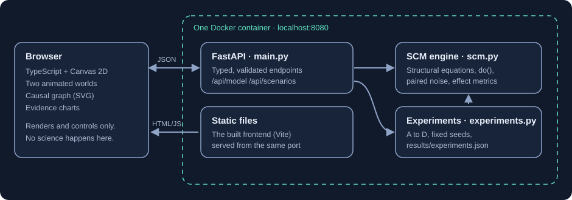

# Architecture

One container, one port, two layers with a strict division of labour.

## The rule

**The backend owns the science. The frontend only draws it.**

Every number on screen, from a pond's size to a metric in a table, comes from a backend response. The frontend contains no model equations and computes no effects. Its only arithmetic on results is linear interpolation between two consecutive daily values so animation looks smooth, and a threshold comparison (using the threshold the backend supplies) to decide when to light up a variable.

## Backend (`backend/app/`)

| File | Responsibility |
|---|---|
| `scm.py` | The structural causal model: variables, edges, equations, `do()`, paired runs, effect metrics. Pure NumPy, vectorised over many worlds. |
| `experiments.py` | The four research experiments and the report writer. Run as `python -m app.experiments`. |
| `main.py` | FastAPI app: request validation with Pydantic, scenario and preset definitions, and static file serving. |

### API

| Endpoint | Purpose |
|---|---|
| `GET /health` | Liveness check used by Docker |
| `GET /api/model` | Variables, equations, edges, descendants, intervention presets, input limits |
| `GET /api/scenarios` | The three climates and their parameters |
| `POST /api/simulate` | Observation: one world, no intervention |
| `POST /api/intervene` | Paired comparison: baseline series, intervened series, affected variables, metrics |
| `POST /api/experiments` | Runs experiments A to D (fixed seeds) and returns the results |

Input is bounded: 60 to 720 steps, seed from 0 to 2³¹−1, intervention value from 0 to 1, intervention variable from a fixed list, unknown fields rejected. Invalid input returns HTTP 422 with details; an unknown scenario returns 404. The experiments endpoint accepts only the experiment letters, so a caller cannot request an arbitrarily large computation. No request content is ever evaluated as code.

Interactive API documentation is available at `/docs` while the app is running.

## Frontend (`frontend/src/`)

| File | Responsibility |
|---|---|
| `app.ts` | Wires controls, the shared clock, and the three views |
| `playback.ts` | The simulation clock both worlds are drawn from, plus sampling helpers |
| `world.ts` | Canvas 2D renderer for one ecosystem |
| `graph.ts` | The causal graph (SVG), built from `/api/model` |
| `evidence.ts`, `charts.ts` | Metrics table, small-multiple line charts, experiment charts |
| `api.ts`, `types.ts` | Typed HTTP client |

Plain TypeScript and Vite. No UI framework and no charting library: the app has three views and a handful of controls, and the charts are small SVGs.

### How the two worlds stay honest

Both canvases use the same renderer, the same layout seed and the same animation clock. A plant, a berry or a creature sits in the same place in World A and World B and follows the same wandering path. The only inputs that differ are the seven state values for that day, so any visible difference between the canvases is a difference in backend state. A browser test verifies this: before the intervention day the two canvases are pixel-identical; afterwards they are not.

| What you see | Driven by |
|---|---|
| Sky brightness, sun glow | Sunlight |
| Cloud cover, number of raindrops | Rainfall |
| Pond area | Water |
| Number and height of plants, hill colour | Vegetation (leaf colour also reflects water) |
| Fruit on plants | Food |
| Number of creatures (out of 20), hop height | Creatures, food |
| Washed-out tint | Health |

## Deployment

A two-stage `Dockerfile` builds the frontend with Node, then copies the static files into a slim Python image that runs Uvicorn as a non-root user. `docker-compose.yml` publishes the port on `127.0.0.1` only. There is no database, cache, queue or external service, and nothing is persisted: every response is a pure function of the request.

## Deliberately left out

Authentication, persistence, user accounts, a database, cloud infrastructure, LLM calls. None is needed to demonstrate the idea, and each would make the project harder to read.
