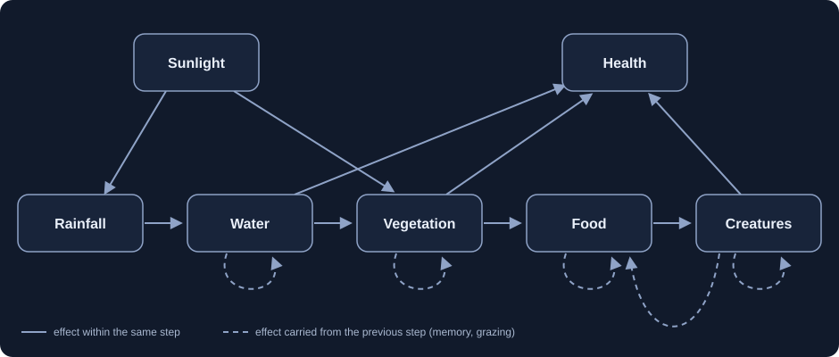

# The causal model

Everything the application shows is produced by one small Structural Causal Model (SCM) in [`backend/app/scm.py`](../backend/app/scm.py). This page states it in full.



## Variables

All seven endogenous variables are numbers between 0 and 1, recomputed once per simulated day.

| Variable | Symbol | Meaning |
|---|---|---|
| Sunlight | S | How clear and bright the sky is |
| Rainfall | R | Rain falling today |
| Water | W | Water stored in the pond and soil |
| Vegetation | V | Plant cover |
| Food | F | Fruit and seeds available |
| Creatures | C | Creature population, as a share of the maximum (20 drawn on screen) |
| Health | H | A summary index of the ecosystem |

**Exogenous variables** (set from outside the model):

- Six independent noise streams `U_S, U_R, U_W, U_V, U_F, U_C`, each standard normal, one value per day.
- The scenario constants: `sun_base`, `rain_base`, `soil`, `season_amp`, and the four starting values `water0`, `vegetation0`, `food0`, `creatures0`.

## Structural equations

`clip` limits a value to the range 0 to 1.

```text
S[t] = clip(sun_base + season_amp * sin(2π t / 120) + 0.04 * U_S[t])
R[t] = clip(rain_base - 0.3 * (S[t] - 0.5)          + 0.10 * U_R[t])
W[t] = clip(0.88 * W[t-1] + 0.12 * R[t]                         + 0.015 * U_W[t])
V[t] = clip(0.94 * V[t-1] + 0.06 * soil * W[t] * (0.4 + 1.2 * S[t]) + 0.010 * U_V[t])
F[t] = clip(0.85 * F[t-1] + 0.15 * V[t] * (1 - 0.3 * C[t-1])    + 0.015 * U_F[t])
C[t] = clip(0.95 * C[t-1] + 0.05 * min(1, 1.5 * F[t])           + 0.010 * U_C[t])
H[t] = 0.3 * W[t] + 0.4 * V[t] + 0.3 * C[t]
```

Read each stock equation as "keep most of yesterday's level and move part of the way toward a target set by the parents". Water moves 12% of the way toward today's rainfall, vegetation 6% of the way toward what water, soil and sunlight can support, and so on. That single pattern makes every variable bounded, easy to interpret, and solvable by hand: with noise switched off the model settles at `W = R`, `V = soil · W · (0.4 + 1.2 S)`, `F = V / (1 + 0.45 V)`, `C = 1.5 F`. The test suite checks the code against exactly these closed forms.

## Time and acyclicity

Within one day the variables are evaluated in the order `S → R → W → V → F → C → H`, which is a topological order of the solid arrows. Feedback exists (stocks remember yesterday; creatures eat food), but it always points from day `t-1` to day `t`. Unrolled over time the graph has no cycles. A test asserts both properties, and a second test confirms that adding a same-day cycle is detected.

## Randomness and seeds

`make_noise(seed, steps)` draws the whole table of disturbances up front from NumPy's `default_rng(seed)`. Consequences:

- The same seed always gives bit-for-bit identical results.
- A shorter run with the same seed is an exact prefix of a longer one.
- Two worlds can be given the *same* table. That is how paired comparisons work.

## Operations

**Observe.** `simulate(scenario, noise)` runs the equations as written.

**Intervene.** `do(X = x)` between a start and end day replaces X's structural assignment with the constant `x`. X stops listening to its parents and to its own noise; everything else is untouched. This is implemented as a replacement of the assignment inside the simulation loop, not as a filter on generated data.

**Compare.** `paired_run` executes the baseline and the intervened world with the same scenario, the same starting state and the same noise table. Any difference between them is therefore a consequence of the intervention alone.

**Explain.** `descendants(X)` walks the graph (including lagged arrows) to list every variable an intervention on X can reach. A parametrised test intervenes on each variable in turn and asserts that the set of variables that numerically changed equals this list exactly, so the drawn graph and the running code cannot drift apart.

**Measure.** `effect_metrics` reports, per variable: final difference, mean difference from the intervention day onward, largest absolute difference, relative effect (omitted when the baseline is zero), and the number of days until the worlds differ by more than 0.02.

## Scenarios

| Scenario | sun_base | rain_base | soil | Character |
|---|---|---|---|---|
| Temperate valley | 0.5 | 0.5 | 0.9 | Balanced |
| Arid basin | 0.7 | 0.35 | 0.75 | Bright and dry |
| Lush wetland | 0.4 | 0.7 | 1.0 | Cloudy, wet, fertile |

## Assumptions, stated plainly

1. The graph and every coefficient were chosen by the author. Nothing was estimated from data.
2. All mechanisms are simple relaxations toward a target. Real ecosystems are not this tidy.
3. Noise terms are independent of each other and across days. There are no hidden common causes beyond the ones drawn.
4. Sunlight was deliberately given two effects (less rain, faster growth) so that it confounds rainfall and vegetation. Experiment C depends on this design choice.
5. Clipping to the range 0 to 1 makes the model slightly nonlinear at the edges.
6. Interventions are "hard": they pin a variable to one value. Softer interventions (shifting a variable, changing a coefficient) are not implemented.
7. Health is a weighted average for display. It has no causal role and cannot be intervened on.
