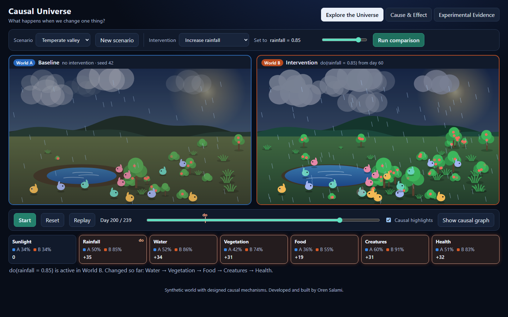
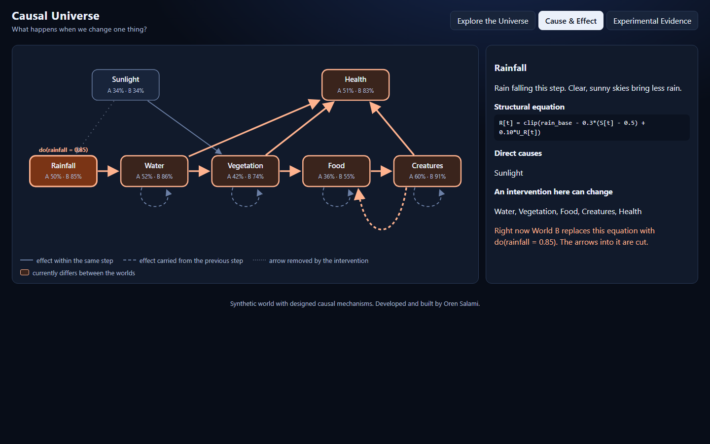
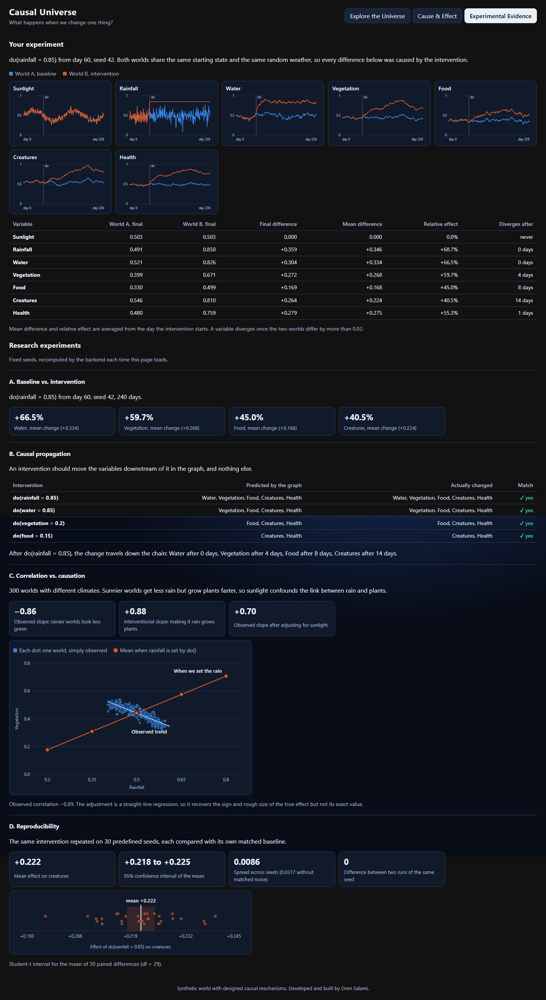

# Experiments and results

Four experiments, all defined in [`backend/app/experiments.py`](../backend/app/experiments.py) with fixed seeds. The numbers below are copied from [`results/experiments.md`](../results/experiments.md); the full machine-readable output, including time series, is in [`results/experiments.json`](../results/experiments.json).

Regenerate everything with:

```bash
cd backend
python -m app.experiments
```

The same experiments are recomputed live by `POST /api/experiments` and shown in the app's Experimental Evidence view.

Unless noted, runs use the Temperate valley scenario for 240 days, with the intervention `do(rainfall = 0.85)` starting on day 60.

## A. Baseline vs. intervention

**Question.** In one world, what does setting rainfall to 0.85 change?

**Method.** One paired run with seed 42. "Mean difference" averages World B minus World A from day 60 to the end. "Relative effect" divides that by World A's mean over the same days.

| Variable | Final, A | Final, B | Final difference | Mean difference | Relative effect | Days to diverge |
|---|---|---|---|---|---|---|
| Sunlight | 0.503 | 0.503 | 0.000 | 0.000 | 0.0% | never |
| Rainfall | 0.491 | 0.850 | +0.359 | +0.346 | +68.7% | 0 |
| Water | 0.521 | 0.826 | +0.304 | +0.334 | +66.5% | 0 |
| Vegetation | 0.399 | 0.671 | +0.272 | +0.268 | +59.7% | 4 |
| Food | 0.330 | 0.499 | +0.169 | +0.168 | +45.0% | 8 |
| Creatures | 0.546 | 0.810 | +0.264 | +0.224 | +40.5% | 14 |
| Health | 0.480 | 0.759 | +0.279 | +0.275 | +55.3% | 1 |

**Reading.** More rain raised every downstream variable, by less at each step down the chain. Sunlight, which is upstream of rainfall, did not move at all.



## B. Causal propagation

**Question.** Does an intervention change the variables the graph says it should, and only those?

**Method.** Four interventions, one at a time, each from day 60 with seed 42. A variable counts as changed if its series differs from the baseline anywhere, by any amount.

| Intervention | Descendants in the graph | Variables that changed | Match |
|---|---|---|---|
| do(rainfall = 0.85) | water, vegetation, food, creatures, health | water, vegetation, food, creatures, health | yes |
| do(water = 0.85) | vegetation, food, creatures, health | vegetation, food, creatures, health | yes |
| do(vegetation = 0.2) | food, creatures, health | food, creatures, health | yes |
| do(food = 0.15) | creatures, health | creatures, health | yes |

Under `do(rainfall = 0.85)` the effect reached each link later than the one before: water on the same day, vegetation after 4 days, food after 8, creatures after 14 (days until the two worlds differ by more than 0.02).

**Reading.** Interventions travel downstream only. Fixing vegetation leaves water and rainfall exactly as they were.



## C. Correlation vs. causation

**Question.** Can simply observing worlds mislead us about what rain does to plants?

**Design.** Sunlight is a deliberate confounder: sunnier steps bring less rain (`R` falls with `S`) and faster plant growth (`V`'s target rises with `S`). That opens a back-door path `rainfall ← sunlight → vegetation`.

**Method.** 300 worlds (seed 2024), each with its own climate, `sun_base` drawn uniformly from 0.2 to 0.8 and no seasonal cycle. The outcome is mean vegetation over the last 120 days.

- *Observational:* let each world run, then regress vegetation on mean rainfall across worlds.
- *Interventional:* in the same 300 worlds with the same noise, set `do(rainfall = r)` for r = 0.2, 0.35, 0.5, 0.65, 0.8 and average vegetation at each level.
- *Adjusted:* regress observed vegetation on rainfall and sunlight together.

| Quantity | Value |
|---|---|
| Observed correlation, rainfall vs. vegetation | −0.885 |
| Observed slope (vegetation per unit of rainfall) | −0.857 |
| Interventional slope | +0.883 |
| Observed slope adjusted for sunlight | +0.699 |
| Correlation, sunlight vs. rainfall | −0.984 |
| Correlation, sunlight vs. vegetation | +0.922 |

Mean vegetation under `do(rainfall = r)`: 0.177, 0.309, 0.442, 0.574, 0.706.

**Reading.** In the observed data, rainier worlds are *less* green. Yet making it rain makes every world greener. The observed association has the wrong sign because rainy worlds are also the dim ones, and dim worlds grow plants slowly. Sunlight explains both.

**About the adjusted slope.** Adjusting for sunlight recovers the correct sign but lands at +0.70 rather than +0.88. This was not investigated further. Plausible contributors, none individually verified: rainfall and sunlight are almost perfectly collinear across worlds (r = −0.98), which leaves little independent rainfall variation to estimate from; the true mechanism multiplies water by sunlight, which a straight-line model cannot represent; and vegetation responds to past rainfall, while the regression uses a same-window average. The honest summary is that a simple linear adjustment gets the direction right and the size roughly right.



## D. Reproducibility

**Question.** Is the effect in Experiment A a property of the model or of one lucky seed?

**Method.** Seeds 1 to 30. For each, a paired run; the effect is the mean difference in creatures from day 60 onward.

| Quantity | Value |
|---|---|
| Mean effect on creatures | +0.2215 |
| Standard deviation across seeds | 0.0086 |
| Range | +0.1993 to +0.2389 |
| 95% confidence interval of the mean | +0.2183 to +0.2248 |
| Standard deviation without paired noise | 0.0317 |
| Largest difference between two runs of seed 42 | 0 (exactly) |

The interval is a Student-t interval for the mean of 30 paired differences (29 degrees of freedom, critical value 2.045). It describes uncertainty about the *average effect across random weather in this model*, nothing more.

**Reading.** The effect is positive for every seed and varies little. Re-running a seed reproduces it bit for bit. Giving the two worlds unrelated noise instead of matched noise makes the estimate about 3.7 times noisier (0.0317 vs. 0.0086), which is the practical reason for pairing.

## Summary

| Idea | Evidence |
|---|---|
| Intervention has measurable downstream effects | A: creatures +40.5% on average after `do(rainfall = 0.85)` |
| Effects follow the causal graph | B: 4 of 4 interventions changed exactly their descendants |
| Observation and intervention can disagree | C: observed slope −0.86, interventional slope +0.88 |
| Results are reproducible | D: identical seeds give identical output; mean +0.222 over 30 seeds |

Every experiment produced the result the model's design predicts. The one figure that is less tidy than it might be, the adjusted slope in C, is reported as measured.
